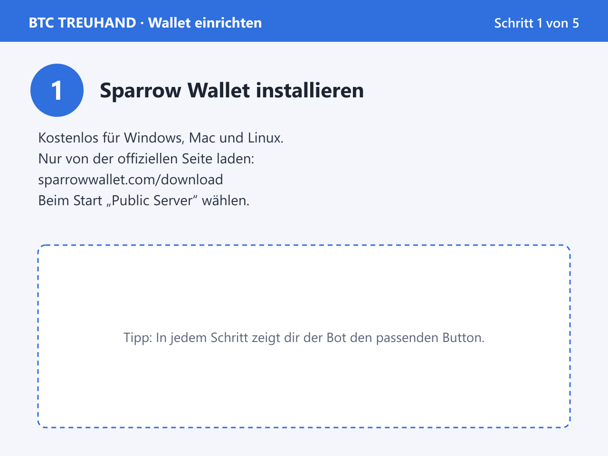
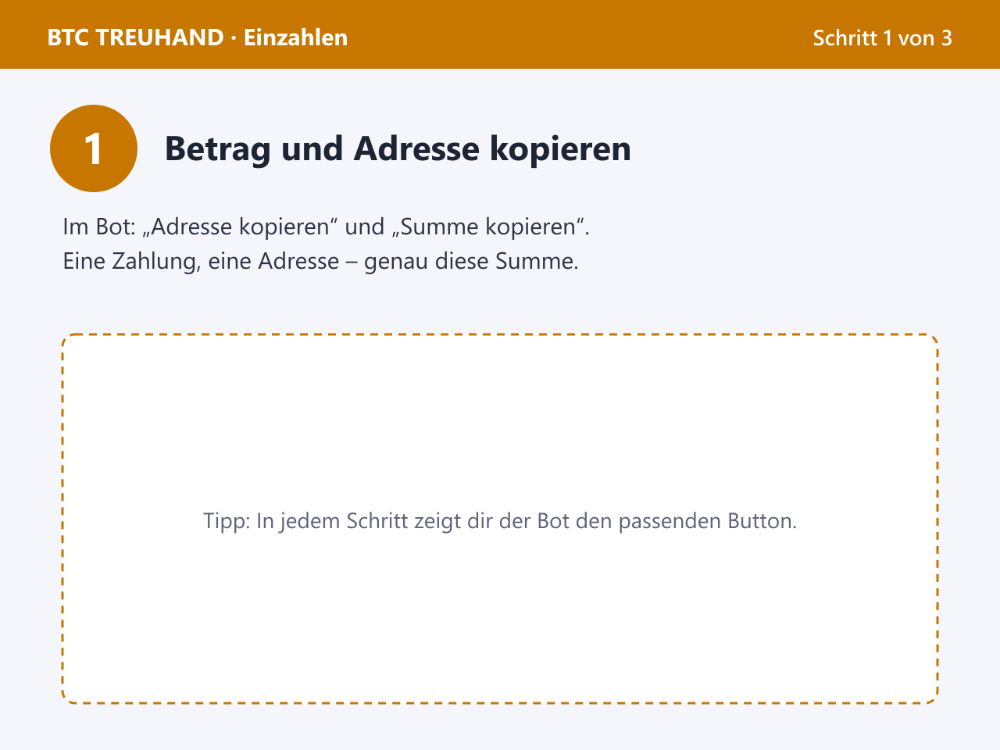
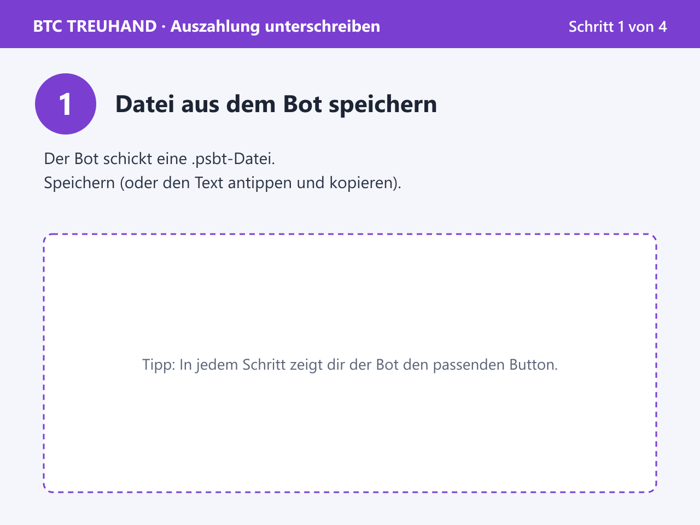

# BTC-Treuhand-Bot für Telegram

Kostenloser, quelloffener **Bitcoin-Treuhand-Bot** für Telegram. Käufer, Verkäufer und ein Schlichter halten je einen Schlüssel einer **2-von-3-Multisig** (P2WSH). Der Bot verwahrt **keine Coins und keine privaten Schlüssel**. Er koordiniert nur: Einladungen, Bedingungen, Adressprüfung, Zahlungserkennung und das gemeinsame Unterschreiben der Auszahlung (PSBT).

Läuft komplett auf **Cloudflare Workers + D1** (Free-Plan reicht zum Start), ohne eigenen Server und ohne eigenen Bitcoin-Node.

Support und Fragen: **[@GruppennetzwerkKontakt_bot](https://t.me/GruppennetzwerkKontakt_bot)**

> ⚠️ **Haftungsausschluss.** Diese Software wurde **nicht extern auditiert**. Nutzung auf eigenes Risiko, ohne Gewährleistung. Sie ist **keine Rechts-, Steuer- oder Finanzberatung**. Wer den Bot betreibt, ist **selbst für die Einhaltung aller Gesetze** verantwortlich (z. B. Erlaubnispflichten, Geldwäscheregeln, Datenschutz; siehe [`docs/LEGAL-CHECKLIST.md`](docs/LEGAL-CHECKLIST.md)). Der Bot kann BTC on-chain **nicht einfrieren oder zurückholen**.

---

## Für Nutzer: So funktioniert ein Handel

1. **Handel anlegen** mit `/newtrade` und die andere Partei per Link + Code einladen.
2. **Bedingungen bestätigen**: Betrag, Leistung und Gebühr stehen fest und werden von allen akzeptiert.
3. **Wallet verbinden**: Jede Partei gibt nur ihren **öffentlichen** Schlüssel (xpub/tpub) an. Daraus entsteht die gemeinsame Treuhand-Adresse, die jeder in seiner eigenen Wallet nachprüfen kann.
4. **Einzahlen**: Der Käufer zahlt **eine Summe an eine Adresse** (Handelsbetrag + Gebühr). Der Bot erkennt die Zahlung und die Bestätigungen automatisch.
5. **Auszahlen**: Nach Lieferung erstellt der Bot die Auszahlung. Zwei von drei Parteien unterschreiben in ihrer eigenen Wallet, fertig.
6. **Streitfall?** Der Schlichter entscheidet und unterschreibt mit einer Partei die Auszahlung oder Rückzahlung.

**Wichtig:** Niemals Wiederherstellungswörter (Seed) oder private Schlüssel an den Bot oder an Personen senden. Der Bot fragt nie danach und warnt, wenn so etwas eingegeben wird.

### Bildanleitungen im Bot

Für jeden Schritt schickt der Bot eine wischbare Bildanleitung (Telegram-Album): Wallet einrichten, Treuhand-Konto prüfen, Einzahlen, Unterschreiben.

| Wallet einrichten | Einzahlen | Unterschreiben |
|---|---|---|
|  |  |  |

---

## Funktionen

- **Nichtverwahrend:** 2-von-3-Multisig, Bot hat keinen Schlüssel und kann nichts allein bewegen.
- **Betreiber-Modus:** Der Betreiber ist automatisch Schlichter (nur öffentlicher Schlüssel im Bot). Servicegebühr (Standard **3 %**) wird mit derselben Einzahlung bezahlt und geht bei jeder Auszahlung als eigener Posten an die Gebührenadresse. Umgehung am Bot vorbei wird erkannt, beide Parteien werden gesperrt.
- **Automatischer Schlichter** oder freie Wahl eines eigenen Schlichters ohne Betreiber-Modus.
- **Admin-Werkzeug** `/admin`: Übersicht, Meldungen zu neuen und hängenden Handeln, Fälle in `NEEDS_REVIEW` auflösen (fortsetzen, schlichten, abbrechen), Nutzer entsperren, alles mit Audit-Log.
- **Bildanleitungen als Album**, passend zum Netzwerk (Signet-Texte nie auf Mainnet).
- **Sichere Einladungen:** Deep-Link + separater Zugangscode (HMAC, Ablauf, Kontobindung, Rate-Limit, Sperre nach Fehlversuchen).
- **Bedingungen als Hash-Snapshot**, von allen Signierern akzeptiert.
- **Zahlungserkennung** per Cron über zwei unabhängige Esplora-Provider mit Gegenprüfung, Bestätigungen und Reorg-Erkennung. Überzahlungen werden akzeptiert (Überschuss geht an den Empfänger der Auszahlung).
- **PSBT (BIP-174)** mit vollständiger Neuprüfung jeder hochgeladenen Datei, BIP-48-Schlüssel mit Key-Origin, importierbarer Descriptor `wsh(sortedmulti(2,…))`.
- **Nur Bitcoin (BTC).** Keine Euro-, Fiat- oder Altcoin-Abwicklung.
- Deutschsprachige Oberfläche mit Buttons, Webhook statt Polling, Löschfristen, Datenschutz-Hinweise.

---

## Für Entwickler und Betreiber

### Schnellstart (lokal)

Voraussetzungen: Node.js ≥ 22.5, Cloudflare-Konto.

```bash
npm ci
npm run check            # Typecheck, Lint, Format, Tests, Worker-Build
npm run verify-signet    # Live-Signet-Check, nur lesend
```

Lokaler Worker: `.dev.vars` anlegen (Vorlage `.env.example`), dann `npm run db:migrate:local` und `npm run dev`.

### Eigenen Bot betreiben

1. Bot bei [@BotFather](https://t.me/BotFather) anlegen.
2. In `wrangler.jsonc` alle mit `PLACEHOLDER` markierten Werte ersetzen (Bot-Username, D1-ID, Gebührenadresse, optional Admin- und Betreiber-Daten). `npm run validate-config` prüft die Werte.
3. Secrets nur per `npx wrangler secret put …` setzen, nie ins Repo.
4. Deployen und Webhook setzen.

Schritt für Schritt: **[`docs/DEPLOYMENT.md`](docs/DEPLOYMENT.md)** · Betreiber-Modus mit Gebühr: **[`docs/OPERATOR-SETUP.md`](docs/OPERATOR-SETUP.md)**

Die mitgelieferte Konfiguration startet auf **Signet** (Testnetz, Coins ohne Wert). Mainnet ist im Code gesperrt und wird erst mit `ALLOW_MAINNET` und einer ausdrücklichen Freigabe-Bestätigung aktiv (siehe [`docs/MAINNET-CHECKLIST.md`](docs/MAINNET-CHECKLIST.md)). Der Code ist mainnet-fähig und läuft dort bereits produktiv; die Freigabe ist aber deine eigene Entscheidung und Verantwortung.

### Teststand

- **126 automatisierte Tests** (Unit, Integration über die echten Telegram-Handler, Security, Fehlerfälle), u. a. alle Signaturkombinationen, manipulierte PSBTs, Gegenprüfung mit bitcoinjs-lib. Smoke-Test in der echten workerd-Runtime.
- **Echter On-Chain-Durchlauf** auf Signet (Mutinynet) mit simuliertem Käufer und Verkäufer: Überzahlung → `NEEDS_REVIEW`, Freigabe mit 3 % Gebühr → `COMPLETE` ([`docs/SIGNET-RUNBOOK.md`](docs/SIGNET-RUNBOOK.md), `npm run e2e`).
- Offen: systematischer Test mit GUI-Wallets ([`docs/WALLET-COMPATIBILITY.md`](docs/WALLET-COMPATIBILITY.md)), externes Audit.

### Technik

TypeScript · Cloudflare Workers + D1 · [grammY](https://grammy.dev) · [@scure/btc-signer](https://github.com/paulmillr/scure-btc-signer) · Esplora (mempool.space, blockstream.info)

### Dokumentation

[Architektur](docs/ARCHITECTURE.md) · [Entscheidungen](docs/DECISIONS.md) · [Abhängigkeiten](docs/DEPENDENCIES.md) · [Sicherheit](docs/SECURITY.md) · [Bedrohungsmodell](docs/THREAT-MODEL.md) · [Abläufe](docs/USER-FLOWS.md) · [Datenschutz](docs/PRIVACY.md) · [Kosten](docs/COSTS.md) · [Limits](docs/API-LIMITS.md) · [Incident Response](docs/INCIDENT-RESPONSE.md) · [Mainnet-Checkliste](docs/MAINNET-CHECKLIST.md) · [Rechtliches](docs/LEGAL-CHECKLIST.md)

Sicherheitslücke gefunden? Bitte nicht öffentlich posten, sondern über den [Support-Bot](https://t.me/GruppennetzwerkKontakt_bot) melden.

---

## Support

Fragen, Hilfe beim Einrichten, Feedback: **https://t.me/GruppennetzwerkKontakt_bot**

## Lizenz

[MIT](LICENSE). Kostenlos nutzbar, veränderbar und weitergebbar, ohne Gewährleistung.
